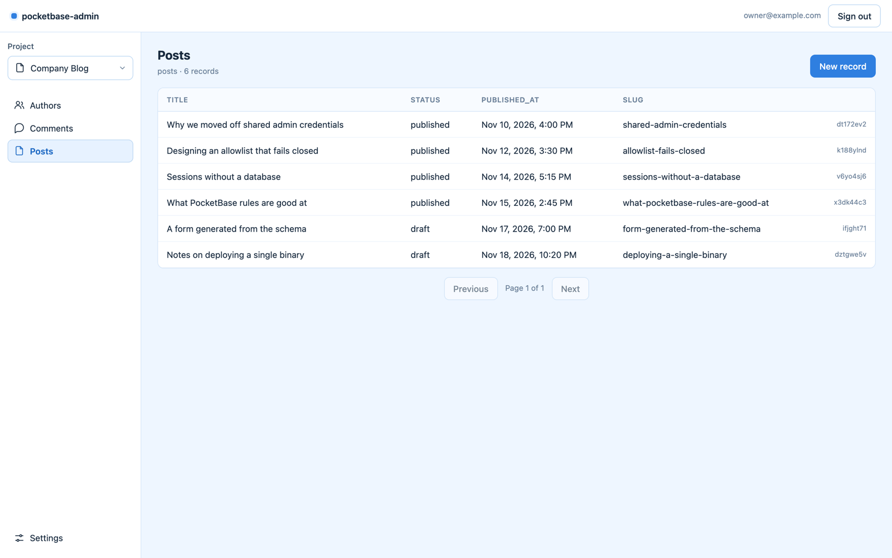
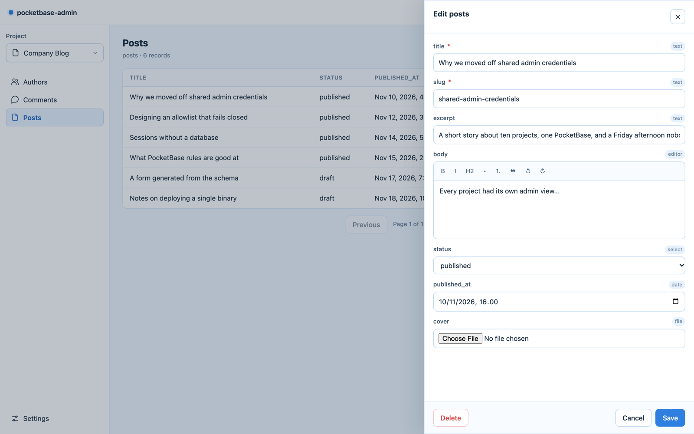
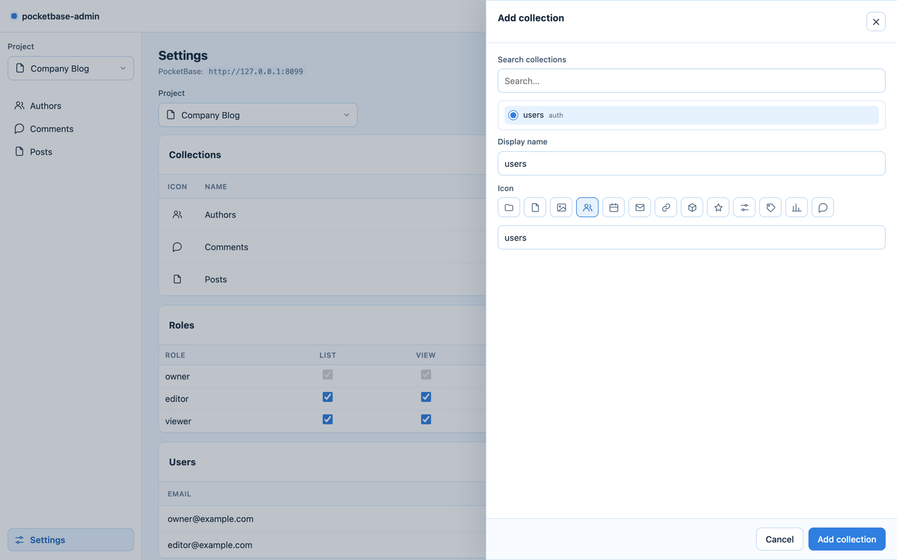
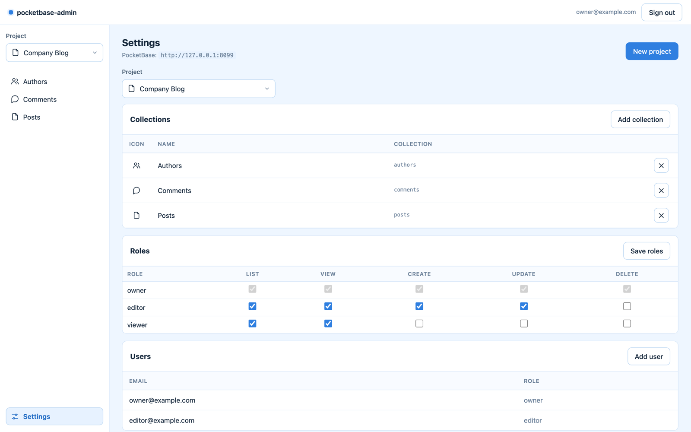

# pocketbase-admin

**A self-hosted admin panel and CRUD API for an existing PocketBase instance, with multi-tenant
role-based access control — without touching a single collection rule.**

[](https://go.dev/dl/)
[](#)
[](#install-on-an-existing-pocketbase)
[](#)

<p align="center">
  
</p>

One binary. One config file. Any number of projects (tenants).

```
Browser ──▶ pocketbase-admin  (auth · RBAC · collection allowlist)
                 │
                 │  superuser token (server-side only)
                 ▼
            PocketBase
```

---

## Why this exists

One PocketBase instance backed several unrelated web projects. Each project had a hand-written
admin view, and each view talked to PocketBase with its own credentials. Two problems followed:

1. **Shared credentials everywhere.** Every project needed a superuser or a hardcoded user id in its
   collection rules. Adding an editor for one project meant touching rules that all projects depend on.
2. **No single place to revoke access.** Removing someone from one project required editing the rules
   of that collection, which is exactly the thing you do not want to touch on a Friday afternoon.

The obvious alternative — PocketBase's own API rules — was rejected on purpose. The rules already
encoded user ids, and rewriting them risked breaking live sites. A per-project npm library was also
rejected: it would have to support Next.js 14.0.3, 14.2.5 and 16 with React 18 and 19 at the same time.

So the boundary moved instead of the data:

- PocketBase keeps its schema, its rules, and its data — unchanged.
- `pocketbase-admin` sits in front of it, authenticates with a superuser account, and decides what a
  tenant's user may do before a request is forwarded.
- A collection that is not in a project's allowlist is **never** proxied, regardless of the role.

The trade-off is deliberate and documented below: **RBAC happens at the application layer, not in the
database.** This is a guard for teams and editors, not a replacement for database security.

---

## What it does

| | |
| --- | --- |
| **Multi-tenant** | Each project is a tenant with its own collection allowlist, roles and users. |
| **Config-driven RBAC** | Roles map to `list`, `view`, `create`, `update`, `delete`, globally or per collection. |
| **Collection allowlist** | Only explicitly enabled collections can be reached through the proxy. |
| **No schema changes** | PocketBase rules and fields stay exactly as they are. Superuser auth bypasses them. |
| **Automatic admin UI** | Tables and forms are generated from the live PocketBase schema. |
| **Rich text** | `editor` fields get a TipTap editor; files upload through multipart. |
| **Setup UI** | Pick collections from the live PocketBase list, define roles, create users. Writes the same `admin.json`. |
| **Renameable** | App name, description and logo are config values: they drive the page title, favicon and topbar. |
| **Preview** | Image files open in a modal instead of a new tab. |
| **Single binary** | The React UI is embedded with `go:embed`. No Node runtime in production. |
| **Flat UI icons** | 13 icons bundled as inline SVG — no icon font, no CDN, no extra dependency. |
| **One dependency** | `golang.org/x/crypto` for bcrypt. Everything else is the standard library. |

## Screenshots

<p align="center">
  
  
</p>
<p align="center">
  
</p>

---

## Security model

Read this before deploying.

```
Browser ──cookie──▶ pocketbase-admin ──superuser token──▶ PocketBase
```

- Tenant users authenticate to **pocketbase-admin**, never to PocketBase. Their passwords are stored
  as bcrypt hashes in `admin.json`.
- Sessions are stateless: an HMAC-SHA256 signed cookie, `HttpOnly`, `SameSite=Lax`, `Secure` when the
  request arrives over HTTPS, 12-hour lifetime. The signing secret lives in the config.
- The PocketBase superuser password is read from `$PB_ADMIN_PASSWORD` (or `${VAR}` expansion in the
  config) and never reaches the browser. The superuser token is cached in memory for 6 hours and
  refreshed once on a `401`.
- Every proxied request is checked twice: the collection must be in the project's allowlist, and the
  role must grant the action mapped from the HTTP method.

**Limit:** authorization is enforced by this service. Anyone with direct access to the PocketBase URL
and valid credentials (or a permissive rule) bypasses it. Keep PocketBase bound to localhost, or reach
it only through a private network.

---

## Install on an existing PocketBase

### 1. Prerequisites

- PocketBase already running and reachable (e.g. `https://pocketbase.example.com`).
- A PocketBase **superuser** account (email + password).
- Go ≥ 1.25 if you build from source. Otherwise use a release binary.

Nothing needs to be created or migrated inside PocketBase.

### 2. Get the binary

Prebuilt binaries for Linux, macOS and Windows are attached to every
[release](https://github.com/jonathantyar/pocketbase-admin/releases) (checksums in `SHA256SUMS.txt`).
Or build from source:

```sh
git clone https://github.com/jonathantyar/pocketbase-admin.git
cd pocketbase-admin
make build          # produces ./pocketbase-admin
```

> The production bundle of the UI is committed under `ui/dist` and embedded, so `go build` alone is
> enough. Node is only required if you change the UI.

### 3. Create the config

```sh
./pocketbase-admin init \
  --config admin.json \
  --pb-url https://pocketbase.example.com \
  --pb-email admin@example.com \
  --project myproject
```

This writes `admin.json` with a random session secret, three starter roles (`owner`, `editor`,
`viewer`) and an empty collection allowlist.

### 4. Provide the superuser password

Prefer the environment variable — the config stays shareable:

```sh
export PB_ADMIN_PASSWORD='your-superuser-password'
```

Or reference it in the config: `"superuserPassword": "${PB_ADMIN_PASSWORD}"`.

### 5. Verify the connection

```sh
./pocketbase-admin doctor --config admin.json
```

```
ok  pocketbase https://pocketbase.example.com (28 collections visible as superuser)
ok  project "myproject": 3 collections, 2 users, 3 roles

all good
```

`doctor` authenticates as superuser, lists collections, and checks that every collection in each
allowlist actually exists. Run it after every config change.

### 6. Start the server

```sh
./pocketbase-admin serve --config admin.json
```

It listens on `127.0.0.1:8092` by default (override with `--http` or `server.addr`).

### 7. Create the first owner

Open the UI. With no users in the config, it starts in **bootstrap** mode: choose a project name,
an email and a password. That account becomes `owner` (all actions). The endpoint closes as soon as
one user exists.

### 8. Configure a project

Open **Settings** as the owner:

1. Select or name the project.
2. Tick the collections this tenant may use — the list comes straight from PocketBase.
3. Adjust the role matrix (`list` / `view` / `create` / `update` / `delete`).
4. Add users with an email, password and role.

Saving writes `admin.json` atomically. The JSON stays the source of truth; you can edit it by hand and
restart at any time.

### 9. Put it behind HTTPS

Never expose the service directly. Example with Caddy:

```caddyfile
admin.example.com {
    reverse_proxy 127.0.0.1:8092
}
```

The service marks the session cookie `Secure` when it sees `X-Forwarded-Proto: https`, which Caddy
sends automatically.

### 10. Run it like a service

```ini
# /etc/systemd/system/pocketbase-admin.service
[Unit]
Description=pocketbase-admin
After=network.target

[Service]
User=pocketbase
WorkingDirectory=/var/lib/pocketbase-admin
Environment=PB_ADMIN_PASSWORD=change-me
ExecStart=/usr/local/bin/pocketbase-admin serve --config /var/lib/pocketbase-admin/admin.json
Restart=always
RestartSec=3s

[Install]
WantedBy=multi-user.target
```

```sh
sudo systemctl daemon-reload
sudo systemctl enable --now pocketbase-admin
```

---

## Configuration

`admin.json` is the single source of truth.

```json
{
  "pocketbase": {
    "url": "https://pocketbase.example.com",
    "superuserEmail": "admin@example.com",
    "superuserPassword": "${PB_ADMIN_PASSWORD}"
  },
  "server": {
    "addr": "127.0.0.1:8092",
    "sessionSecret": "64-random-hex-chars",
    "appName": "pocketbase-admin",
    "appDescription": "Admin panel for PocketBase with multi-tenant RBAC",
    "logo": "box",
    "pocketbaseVersion": "0.40.5"
  },
  "projects": {
    "myproject": {
      "label": "My Project",
      "collections": {
        "posts": { "label": "Posts", "icon": "📝", "listFields": ["title", "slug", "created"] },
        "comments": { "label": "Comments", "icon": "💬" }
      },
      "roles": {
        "owner":  { "label": "Owner",  "actions": ["*"] },
        "editor": {
          "label": "Editor",
          "actions": ["list", "view", "create", "update"],
          "collections": { "posts": ["list", "view", "update"] }
        },
        "viewer": { "label": "Viewer", "actions": ["list", "view"] }
      },
      "users": [
        { "email": "editor@example.com", "passwordHash": "$2a$10$...", "role": "editor" }
      ]
    }
  }
}
```

- `server.appName`, `server.appDescription` and `server.logo` are optional branding. They set the page
  title, the meta description, the favicon and the topbar logo, and can be edited in Settings.
  `server.logo` takes any bundled icon name.
- `server.pocketbaseVersion` is optional and only shown as a badge next to the logo. PocketBase does
  not expose its version over HTTP, so set it by hand to match the instance you point at.

**Rules**

- `projects.<name>.collections` **is** the allowlist. A collection absent from it can never be reached.
- Each allowlist entry can carry a `label` (shown in the sidebar) and an `icon`. Icons are bundled
  names: `folder`, `file`, `image`, `users`, `calendar`, `mail`, `link`, `box`, `star`, `settings`,
  `tag`, `chart`, `message`. An unknown value renders as text, so emoji still work. Both fields are
  optional.
- `roles.<role>.actions` applies to every collection in the project. `roles.<role>.collections`
  overrides it per collection. `"*"` means every action.
- A user may belong to several projects; their role is looked up per project.
- `"${ENV_VAR}"` is expanded on load. If `superuserPassword` is empty, `$PB_ADMIN_PASSWORD` is used.
- The file is written atomically (temp file + rename, mode `0600`) and contains password hashes —
  treat it as a secret.

---

## CLI

```
pocketbase-admin init   --config admin.json --pb-url URL --pb-email EMAIL [--project default]
pocketbase-admin serve  --config admin.json [--http 127.0.0.1:8092]
pocketbase-admin doctor --config admin.json
pocketbase-admin hash   --password 'secret'
pocketbase-admin version
```

---

## HTTP API

Everything under `/api` requires the session cookie, except `/api/meta`, `login` and the bootstrap call
while no user exists.

| Method | Path | Purpose |
| --- | --- | --- |
| `GET` | `/api/meta` | public branding: app name, description, logo, PocketBase version |
| `POST` | `/api/login` | `{email, password}` → sets the session cookie |
| `POST` | `/api/logout` | clears the cookie |
| `GET` | `/api/me` | current user, projects, roles, per-collection actions, `setup` flag |
| `GET` | `/api/p/{project}/collections` | collections this user may list |
| `GET` | `/api/p/{project}/schema/{collection}` | raw PocketBase collection schema (for forms) |
| `ANY` | `/api/p/{project}/collections/{col}/records[/{id}]` | proxied CRUD |
| `GET` | `/api/p/{project}/files/{col}/{record}/{file}` | proxied file download (`view` required) |
| `GET` | `/api/setup/config` | config without hashes or secrets |
| `GET` | `/api/setup/collections` | live collection list from PocketBase |
| `POST` | `/api/setup/app` | update app name, description, logo and version badge |
| `POST` | `/api/setup/project` | upsert a project (label, allowlist, roles) |
| `POST` | `/api/setup/collection` | add a collection to a project with its label and icon |
| `DELETE` | `/api/setup/collection?project=&name=` | remove a collection from the allowlist |
| `POST` | `/api/setup/user` | create a user, or reset an existing one's password/role |
| `POST` | `/api/setup/bootstrap` | create the first owner (only while the config has no users) |

`/api/setup/*` requires a role containing `"*"` in at least one project.

---

## UI

A light-themed React + Vite + TipTap single-page app, embedded into the binary.

- **Login** / first-run **bootstrap**.
- **Project switcher** with the project's icon and label.
- **Sidebar** listing the collections the current role can list, each with its configured icon.
- **Table** with pagination; columns come from `listFields` or the first schema fields, and dates are
  formatted for humans.
- **Record drawer** generated from the PocketBase schema: text, email, url, number, bool, date,
  single/multi select, relation, json, file upload, and a rich text editor. Buttons follow the role's
  permissions, and PocketBase validation errors are shown per field.
- **Settings** (requires a role containing `"*"`), laid out as three lists, each edited in the same
  right-hand drawer as records:
  - **Collections** — add a collection from the live PocketBase list, set a display name and an icon,
    or remove one from the allowlist.
  - **Roles** — toggle `list`/`view`/`create`/`update`/`delete` per role and save.
  - **Users** — add an email, password and role, or reset an existing user by entering the same email
    again.
  - **New project** — name, label and the first owner account.

Develop it with:

```sh
cd ui
npm install
npm run dev     # http://localhost:5173, proxies /api to :8092
```

Then rebuild the binary so the new assets are embedded.

---

## Development

```sh
make build      # build the Go binary (UI already embedded)
make test       # go test ./... with -race
make vet        # go vet ./...
make fmt        # gofmt -w .
make check      # fmt + vet + test
make ui         # rebuild the embedded UI (npm install + npm run build)
make run        # build and serve with CONFIG=admin.json
make doctor     # run doctor with CONFIG=admin.json
make clean      # remove the binary
```

Layout:

```
main.go                      CLI (init / serve / doctor / hash / version) + UI embed
internal/config/             config schema, allowlist, RBAC, atomic store, tests
internal/auth/               bcrypt + HMAC session tokens, tests
internal/pb/                 PocketBase superuser client (cached token, one retry)
internal/server/             HTTP routes, authorization, proxy, setup API, SPA serving
ui/                          React + Vite + TipTap frontend
ui/dist/                     built assets, embedded via go:embed (committed)
docs/                        screenshots used by this README
```

---

## Limitations

- **RBAC is application-level.** See the security model above.
- Public PocketBase file rules still expose files if someone knows the PocketBase URL; this proxy
  hides the path, it does not lock storage.
- `relation` fields are edited as raw record ids. The schema endpoint exposes `collectionId`, not the
  target collection name, so a picker needs an extra lookup.
- No audit log and no field-level masking yet.
- One admin instance serves one PocketBase instance.
